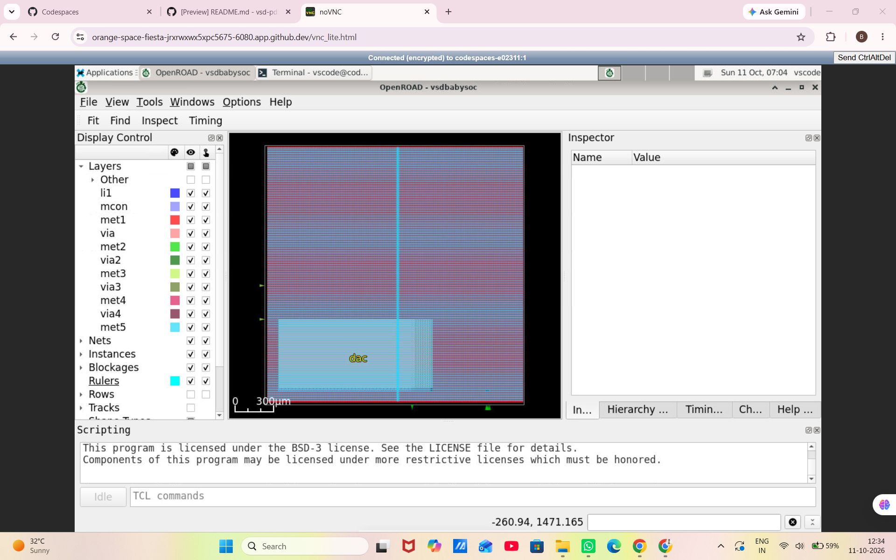

# VSDBabySoC — Physical Design Flow

## 📌 Project Overview

This project demonstrates the physical-design implementation flow of **VSDBabySoC** using **OpenROAD** and the **Sky130HD** technology platform.

The design is examined across five major physical-design stages, from floorplanning to detailed routing and final-layout generation. Screenshots from the implementation environment are included as visual evidence of the work performed at each stage.

## 🛠️ Tools and Technology

- **Design:** VSDBabySoC
- **Physical-design tool:** OpenROAD
- **Timing analysis:** OpenSTA
- **Technology platform:** Sky130HD
- **Implementation artifacts:** OpenROAD database (`.odb`), DEF, reports, and other generated design files

## 🔄 Physical Design Stages

### 1. Floorplanning

Floorplanning establishes the initial physical organization of the design. It defines the core and die regions and provides the foundation for placing standard cells and planning the power distribution and routing resources.

**Key activities:**
- Initialize the physical-design floorplan.
- Define the core and die dimensions.
- Establish placement and routing regions.
- Review the initial physical layout.

**Screenshots:**

*Figure 1.1: Initial floorplan view.*

*Figure 1.2: Floorplan Zoomed view.*

---

### 2. Placement

Placement determines the physical locations of standard cells within the floorplan. The objective is to create a legal and efficient placement while considering timing, congestion, and wirelength.

**Key activities:**
- Place standard cells within the core region.
- Optimize placement for timing and wirelength.
- Examine cell distribution and placement density.
- Review the placement-stage layout.

**Screenshots:**

*Figure 2.1: Standard-cell placement view.*

*Figure 2.2: Placement Zoomed view.*

---

### 3. Clock-Tree Synthesis (CTS)

Clock-tree synthesis builds the clock distribution network required to deliver the clock signal to sequential elements. It inserts and configures clock buffers and other clock-tree cells to manage clock latency and skew.

**Key activities:**
- Build the clock distribution network.
- Insert clock buffers and inverters where required.
- Analyze clock latency and skew.
- Review the design after clock-tree synthesis.

**Screenshots:**

*Figure 3.1: Clock-tree synthesis view.*

*Figure 3.2: CTS Zoomed.*

---

### 4. Global Routing

Global routing is an important stage that plans the approximate routing paths for nets across the design. It assigns routing resources to connections and helps identify potential congestion before detailed routing.

**Key activities:**
- Plan routing paths for signal nets.
- Assign approximate routing resources.
- Examine routing congestion and capacity.
- Review global-routing results before detailed routing.

**Screenshots:**

*Figure 4.1: Global-routing layout overview.*

*Figure 4.2: Global-routing Zoomed.*

Global routing provides an estimate of routing paths and resource usage. It does not, by itself, prove that all nets have been fully routed or that all design-rule checks have passed.

---

### 5. Detailed Routing and Final Layout

Detailed routing converts the global-routing plan into actual routing geometry on the available metal layers and connects the design nets. The final implementation database and exported layout files can then be inspected, subject to the completion of the required checks.

**Key activities:**
- Route nets using detailed metal-layer geometry.
- Inspect routed interconnect and via connections.
- Review detailed-routing and design-rule-check reports.
- Examine final implementation outputs where generated.

**Screenshots:**

*Figure 5.1: Detailed-routing interconnect view.*

## 📁 Important Implementation Artifacts

Depending on the stages completed in the run, the OpenROAD flow may generate artifacts such as:

| Stage | Example artifact |
|---|---|
| Floorplanning | `2_floorplan.odb` |
| Placement | `3_place.odb` |
| Clock-tree synthesis | `4_cts.odb` |
| Global routing | `5_1_grt.odb` |
| Detailed routing | `5_route.odb` |

## ⚠️ Limitations and Future Work

- Investigate the failing setup paths, especially at `ss_n40C_1v28`.
- Review timing constraints, including clock definitions and input/output delays.
- Inspect detailed-routing DRC reports and resolve any remaining violations.
- Verify final-layout export and required physical-verification checks.
- Perform the required signoff analysis with appropriate corner-specific assumptions.

## ✅ Conclusion

This project demonstrates the major stages of the VSDBabySoC physical-design flow using OpenROAD and Sky130HD, supported by implementation screenshots and multicorner timing results.

The report documents the implementation stages and timing-analysis findings while distinguishing completed analysis from timing closure and full physical signoff.

## 👨‍🎓 Student Details

- **Name:** B. Rohith Reddy
- **Roll Number:** 25EG504B06
- **Department:** Electronics and Communication Engineering (ECE)
- **Section:** B
- **University:** Anurag University

